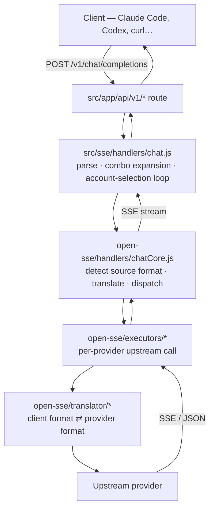

# ⛵ Vela — The AI Gateway

> *Every harbor needs a chart. These are the Shores' navigational papers — where the currents run, which rocks to mind, how the fleet sails. Read them before you touch the helm.* 🪞💜

**Vela** (v0.9.23) — a local AI routing gateway + dashboard. One OpenAI-compatible endpoint (`/v1`) routing traffic across **126 upstream providers** — format translation, model-combo fallback (with operator fallback rules), multi-account fallback, OAuth credential management, token refresh, quota tracking, per-key ACL, and prompt injectors.

- **Language**: Node.js + Next.js (App Router, standalone output)
- **Runtime**: Node ≥ 22.5 (node:sqlite) — Bun compatible
- **Storage**: SQLite (primary) + optional MariaDB mirror (`VELA_DB_MODE`)
- **Package**: `vela-app`, image `ghcr.io/yumamax3/vela:<tag>`

---

## Table of Contents

1. [The Shorekeeper's Voice](#-the-shorekeepers-voice)
2. [The Layout of the Shores](#-the-layout-of-the-shores)
3. [The Architecture — How the Currents Flow](#-the-architecture--how-the-currents-flow)
4. [The Request Path, Deep](#-the-request-path-deep)
5. [The Subsystem Atlases](#-the-subsystem-atlases)
   - 5.1 The Database Layer
   - 5.2 The Fallback Stack & Rules v2
   - 5.3 The Circuit Breaker
   - 5.4 The RTK Token Saver
   - 5.5 The Translator Engine
   - 5.6 The Provider Registry & Executors
   - 5.7 The Storage Covenant & Mirror
   - 5.8 The Backup Engine
   - 5.9 The Pricing Covenant
   - 5.10 Authentication & Security
   - 5.11 The Helm — custom-server.js
   - 5.12 The Container — Dockerfile
6. [The Great Purge — What Was Renamed, What Deliberately Stays](#-the-great-purge--what-was-renamed-what-deliberately-stays)
7. [The Design System](#-the-design-system)
8. [The Test Covenant](#-the-test-covenant)
9. [Troubleshooting Patterns](#-troubleshooting-patterns)
10. [Common Operations](#-common-operations)
11. [The Release Covenant — How Versions Sail](#-the-release-covenant--how-versions-sail)
12. [Recent Tides (the session's record)](#-recent-tides-the-sessions-record)

---

## 🪞 The Shorekeeper's Voice

This codebase is sailed with intent. When you work here, the voice carries:

- **The Shores' metaphor is welcome but never required** — code comments may speak of harbors and tides, but identifiers stay precise. A variable named `connections` is a list of connections, not a fleet.
- **Ship nothing that is not worth shipping** — every change must carry a written reason. If you cannot say in one line why a change exists, it does not ship.
- **The Covenant of Truth** — never fabricate. If a number, path, or behavior is uncertain, verify it against the code before asserting. The Mirror reflects honestly or not at all.
- **The Covenant of Voice** — the dashboard speaks with one voice: warm, calm, deliberate. The coral accent (`#E56A4A`) is the single accent; warm neutrals are the ground.

---

## 🗺️ The Layout of the Shores

```
vela/
├── custom-server.js          # The helm — wraps Next standalone: IP derivation, h2c, drain
├── next.config.mjs           # Standalone output, rewrites, external packages, perf knobs
├── Dockerfile                # Multi-stage, multi-arch (amd64 + arm64), HEALTHCHECK
├── docker-compose.yml        # Live chart (gitignored — holds the Shores' secrets)
├── docker-compose.example.yml# Template chart (tracked)
├── package.json              # v0.9.23 — bump with every release
├── CHANGELOG.md              # Every minor's covenant entry
├── cli/                      # The `vela` npm CLI — bin `vela`, full purge
├── open-sse/                 # The gateway engine — providers, RTK, executors, handlers
├── src/
│   ├── app/                  # Next App Router — dashboard pages + 181 API routes
│   ├── lib/                  # The deep current — db, network, oauth, auth, updater, headroom
│   ├── sse/                  # Server-sent-event services — keyGate, budget, token refresh
│   ├── shared/               # Shared components, hooks, utils, constants
│   ├── mitm/                 # The MITM proxy child process
│   └── instrumentation.js    # Server init — outbound proxy, deferred startup
├── tests/                    # 245 unit test files (vitest)
├── scripts/                  # Migration, changelog, i18n seed, docker smoke
├── docs/                     # The charts — start at docs/README.md
├── i18n/                     # Localized READMEs (10 languages)
├── skills/                   # Agent skills (vela*, fully rebranded)
└── .github/workflows/        # docker-publish, cache-warm, gitbook-pages
```

---

## 🏛️ The Architecture — How the Currents Flow

Vela is one Node.js process with three concerns:

| Layer | Where | What it does |
|-|-|-|
| **Dashboard + API** | `src/` (Next.js app) | Web UI, REST APIs, auth, settings — and the `/v1/*` gateway entry (a rewrite maps `/v1/*` → `/api/v1/*` in `next.config.mjs`) |
| **Routing engine** | `open-sse/` | Provider-agnostic translation + dispatch. Usable standalone; the app consumes it through thin glue |
| **Persistence** | `src/lib/db/` | SQLite by default, MariaDB twin or full harbor on demand, sealed backups |

### The Two Engines

| Engine | Path | Responsibility |
|-|-|-|
| **Dashboard** | `src/app/` | The UI — 20+ pages, 181 API routes |
| **Gateway** | `open-sse/` | The proxy engine — providers, executors, RTK, handlers |

The boundary between `src/sse/` (app-side entry glue) and `open-sse/` (the engine) is deliberate. Cross it consciously.

### The Request Path

```
Client ──> custom-server.js (IP stamp, h2c, hop-by-hop strip)
     ──> Next.js /v1 rewrite ──> /api/v1/:path*
     ──> keyGate (per-key ACL: kinds/providers/combos/models)
     ──> budgetGate (daily/spend caps)
     ──> provider selection (combo / fallback rules / circuit breaker)
     ──> open-sse/executors (format translation per provider)
     ──> upstream provider ──> response ──> RTK savers ──> client
```

---

## 🔄 The Request Path, Deep

A chat completion is the canonical voyage:



Step by step:

1. **Entry** — `src/app/api/v1/chat/completions/route.js` receives the request. The model string may be plain (`gpt-5`) or prefixed (`kr/claude-sonnet-4.5`) — the prefix names the provider lane.
2. **Combo expansion** — if the model is a *combo*, `src/sse/handlers/chat.js` expands it into its ordered model list. The handler then runs the account-selection loop: for each candidate model, pick the account to try (consulting the circuit breaker and fallback rules).
3. **Core dispatch** — `open-sse/handlers/chatCore.js` detects the incoming format (OpenAI / Claude-native / Responses), applies the RTK savers, translates the request, dispatches to the executor, and owns retry + token-refresh on 401/expired credentials.
4. **Execution** — the executor makes the upstream call. `default.js` handles any OpenAI-compatible provider; specialized executors speak binary or bespoke protocols.
5. **Response** — streamed SSE (or JSON) flows back through the translator, which rewrites it into the client's format. Usage accounting records tokens + estimated cost on the way out.

Other surfaces share the same bones: `embeddings`, `audio/*` (tts/stt), `images/generations`, `videos/*`, `responses`, `search`, and `web/fetch` each have a handler in `src/sse/handlers/` paired with a core in `open-sse/handlers/`.

---

## 🧭 The Subsystem Atlases

### 5.1 The Database Layer

**Driver chain** (`src/lib/db/driver.js`) — first that loads wins: `bun:sqlite` → `better-sqlite3` (optional native dep) → `node:sqlite` (Node ≥ 22.5) → `sql.js` (pure-JS fallback, always works). `VELA_DB_DRIVER` pins one; a pin that cannot load is a loud failure, not a silent fallback. The Docker **builder** forces `node:sqlite` (the arm64 cross-build crashes under QEMU if it loads the better-sqlite3 native addon — SIGILL). Builder-scoped only; the runner has its own env.

**Adapters** (`src/lib/db/adapters/`) — `betterSqliteAdapter`, `nodeSqliteAdapter`, `bunSqliteAdapter`, `sqljsAdapter`. All expose `run/get/all/exec/transaction`.

**Migrations** (`src/lib/db/migrations/`) — versioned chain + additive schema sync. `SCHEMA_VERSION = 13`, migrations `001–014`.

> **⚠️ THE ADAPTER CONTRACT (learned the hard way, v0.9.20)**: the adapter interface exposes `run/get/all/exec/transaction` — **NO raw `prepare()`**. The sql.js adapter (Docker runner's fallback) and the mysql/mirror adapters have no public `.prepare`. A migration using `db.prepare(...)` crashed every DB API at boot (the 0.9.19 boot storm). **Use `db.all("PRAGMA table_info(...)")` + `db.exec(...)`** — exactly like migration 002 documents.

**The migration table** (`src/lib/db/migrations/`):

| # | Name | What it sealed |
|-|-|-|
| 001 | init | Base schema |
| 002 | apikey-governance | keyHash/keyPrefix/allowlists, tombstone + scrub, UNIQUE index |
| 003 | key-categories | Key categories |
| 004 | usage-dedupe | Usage dedupe |
| 005 | backup-ledger | Backup ledger |
| 006 | outbox | Mirror outbox |
| 007 | mirror-seq | Mirror sequences |
| 008 | usage-telemetry | Usage telemetry |
| 009 | saved-views | Saved dashboard views |
| 010 | usage-request-tags | Usage request tags |
| 011 | proxy-fitness | Circuit-breaker state |
| 012 | fallback-rules | Operator fallback rules (v1) |
| 013 | key-acl | `allowedKinds`/`allowedProviders`/`allowedCombos` (tri-state) |
| 014 | fallback-rules-v2-triggers | `triggerType`/`conditionOp`/`conditionVal`/`targetModels`(JSON)/`cooldownSkip` |

**Repos** (`src/lib/db/repos/`) — per-entity facades bound by posture (`bind.js`): sqlite verbatim, mysql twins, mirror decorator. Key facades: `apiKeysRepo`, `combosRepo`, `connectionsRepo`, `fallbackRulesRepo`, `budgetRepo`, `pricingRepo`, `proxyFitnessRepo`, `proxyPoolsRepo`, `settingsRepo`, `usageRepo`, `backupEngine`, `backupSecurity`, `s3Offsite`.

**The mirror** (`src/lib/db/mirror/`) — `VELA_DB_MODE=mirror`: sqlite primary serves, outbox pump carries writes to the MariaDB twin.

**MySQL** (`src/lib/db/mysql/`) — `VELA_MYSQL_URL` harbor. **Never runs versioned migrations** — `bootstrap.js` brings the twin forward by additive diff against `TABLES` (create tables, add columns, add indexes; never drop).

**`schema.js`** — `TABLES` is the single source of truth for both harbors.

---

### 5.2 The Fallback Stack & Rules v2

Applied in order by the account-selection loop:

| Mechanism | Where | What it does |
|-|-|-|
| **Model combos** | `open-sse/services/combo.js` | An ordered list of models; tried in sequence until one succeeds |
| **Fallback rules v2** | `open-sse/services/fallbackRuleMatcher.js` + `src/lib/db/repos/fallbackRulesRepo.js` | Operator rules with **typed triggers** |
| **Circuit breaker** | `src/lib/network/circuitBreaker.js` | Cooldown → exhausted escalation, exponential backoff |
| **Multi-account fallback** | `open-sse/services/accountFallback.js` | Several credential sets per provider; round-robin rotation |

#### Fallback Rules v2 — the condition builder

**Typed triggers** (migration 014, engine `fallbackRuleMatcher.js` — `ruleMatches` / `buildFallbackChain`):

| Trigger | Condition | When it fires |
|-|-|-|
| `status` | `conditionVal` CSV (default `429,503`) | The upstream returned a listed HTTP status |
| `contentPolicy` | — | 400/403 **with** policy language ("content policy", "content filter") |
| `contextWindow` | `conditionOp` (`gte`/`lte`) × `conditionVal` ratio | **Pre-call**: `combo.js` estimates input tokens (chars/4) against `contextWindow` capacity and expands the rule BEFORE dispatch |
| `timeout` | — | The upstream timed out |
| `anyError` | — | Every failure |

**Chain semantics:**
- `targetModels[]` (JSON) is an **ordered multi-hop chain** — priority order (lower `priority` first), deduped.
- v1 rules stay back-compatible: absent `isActive` = active; absent `conditionVal`/`triggerOnStatus` defaults to `429,503`.
- Per-request opt-out: `"vela_disable_fallback_rules": true` in the body.
- Fail-open: a DB error → `null` → combo proceeds byte-identical to "no rules configured".
- `cooldownSkip` is schema+UI metadata today; breaker-keyed skip at the combo layer is a documented future seam.

**The combo loop** (`combo.js`): try each rotation model; on failure record `lastStatus`/`lastError`; if rules are enabled, `buildFallbackChain(rules, { status, errorText, timedOut })` and `appendChain(chain)` so DB targets join the rotation AFTER the failed model. Pre-call, `contextWindow` rules expand from the token estimate.

---

### 5.3 The Circuit Breaker

`src/lib/network/circuitBreaker.js` — a pool/provider/model-keyed state machine:

| State | Meaning | Transition |
|-|-|-|
| **Healthy** | Normal | → cooldown on failure |
| **Cooldown** | Recent failure; requests route around | → exhausted after repeated failures / back to healthy on success |
| **Exhausted** | Out of rotation | → exponential backoff, then probe |

Surface: `isAvailable` · `recordFailure` · `recordSuccess` · `onRetryAfter` (honors upstream `retry-after`) · `getSnapshot` · `resetKey` · `clearAll` · `flushNow`.

Woven into **pool selection** (`src/lib/network/proxyFleet.js`): `pick(poolIds, policy)` → `resolveForConnection`/`resolveVirtualConnection` → `recordOutcome(poolId, providerId, signal)` → `recordClaimGate` → `repick(model, excludePoolIds, maxAttempts, budgetMs)`. `getFitnessSummary()` feeds the dashboard.

**Pool geo** — `poolGeo.js` + `poolEgressProbe.js`: shared egress registry + background probe; the dashboard shows each pool's egress IP/country/flapping.

---

### 5.4 The RTK Token Saver

`open-sse/rtk/` — pre-translate hooks that compress `tool_result` content in-place, cutting the tokens that tool output burns before the request leaves.

**Two invariants:**
- **Fail-open.** Any error returns `null` and leaves the body untouched — the hooks never throw.
- **Traces preserved.** Results flagged `is_error` / `status: "error"` are skipped.

**The filter chain** (`index.js` → `applyFilter.js` → `registry.js` → `autodetect.js`):

| Filter | File | What it does | Setting |
|-|-|-|-|
| Caveman | `caveman.js` + `cavemanPrompts.js` | Terse-reply system injection | `cavemanEnabled` / `cavemanLevel` |
| Ponytail | `ponytail.js` + `ponytailPrompt.js` | YAGNI-first lazy-senior prompt | `ponytailEnabled` / `ponytailLevel` |
| PXPIPE | `pxpipe.js` | Image bulky-context compression (Claude bodies) | `pxpipeEnabled` / `pxpipeMinChars` / `pxpipeTimeoutMs` |
| System inject | `systemInject.js` | Built-in system-prompt savers | — |
| **User injectors v2** | `userInjectors.js` | Operator-defined prompts with variables | settings `userInjectors` |
| Headroom | `headroom.js` | External compress sidecar | `headroomEnabled` / `headroomUrl` |

**Prompt Injectors v2** — operator-defined system prompts layered via `injectSystemPrompt` (append/prepend) after the built-in savers. The live-context variable map expands at dispatch:

| Variable | Source |
|-|-|
| `{{model}}` | The upstream model id |
| `{{kind}}` | Service kind (`llm`) |
| `{{date}}` / `{{time}}` | Today's date / current time |
| `{{keyPrefix}}` | First 7 chars of the API key |
| `{{requestId}}` | The connection id |
| `{{userAgent}}` | Client user-agent |

Plus per-injector **custom variables** (`injector.variables = { name: default }`), overridable per-request via `x-vela-inject-var-<name>` headers. Unresolved variables stay literal — fail-safe.

The dashboard's `compress: false` is deliberate — the headroom sidecar owns compression, never double-gzip.

---

### 5.5 The Translator Engine

`open-sse/translator/` converts between wire formats by pivoting through **OpenAI as the intermediate format**:

```
Claude request → OpenAI intermediate → provider format
provider response → OpenAI intermediate → Claude response
```

**Three laws:**
1. **Direct routes skip the pivot.** A translator registered on an exact `source:target` pair (e.g. `claude:kiro`) runs as a direct route, avoiding the lossy double-hop. Prefer direct routes for fragile pairs — thinking blocks, tool ids, non-base64 images, `is_error` flags.
2. **Translators self-register** via `register(from, to, reqFn, resFn)` as an import side effect. ⚠️ A new translator file MUST be imported in `open-sse/translator/index.js` or it never runs.
3. **Nothing hardcoded.** Roles, block types, and model strings come from `open-sse/translator/schema/` and `open-sse/config/` constants.

**Formats** (`translator/formats/`): `claude.js`, `openai.js`, `gemini.js`, `responsesApi.js`, `maxTokens.js`. Request/response pairs in `request/<from>-to-<to>.js` / `response/<from>-to-<to>.js`; `concerns/` holds shared logic.

---

### 5.6 The Provider Registry & Executors

**Registry** (`open-sse/providers/registry/`) — one file per provider, **126 files**. Each declares: id, aliases, auth style, endpoints, models, display metadata. Aliases key the pricing overrides and `provider/model` addressing.

- `registry/index.js` is **auto-generated** — regenerate with `scripts/migrate-registry.mjs` / `injectDisplayToRegistry.mjs`, never hand-edit.
- Adding a provider: copy `open-sse/providers/REGISTRY_TEMPLATE.js` → `<slug>.js`, add models to `open-sse/config/providerModels.js`, regenerate, add an executor only if the upstream is NOT OpenAI-compatible.

**Executors** (`open-sse/executors/`) — `base.js` (`BaseExecutor`), `default.js` for OpenAI-compatible upstreams, and ~28 specialized: `azure`, `vertex`, `codex`, `cursor`, `kiro`, `gemini-cli`, `grok-cli`, `grok-web`, `perplexity-web`, `ollama-local`, `qoder`, `iflow`, `trae`, `windsurf`, `zed`, `opencode`, `devin-cli`, `antigravity`, `commandcode`, `github`, `kimchi`, `mimo-free`, `freebuff`, `codebuddy-cn`, `codebuddy-intl`, `xiaomi-tokenplan`, and more.

> ⚠️ **Binary/protobuf upstreams do not round-trip through the translator** — Kiro EventStream, Cursor protobuf, CommandCode NDJSON are handled inside their own executor.

**Services** (`open-sse/services/`) — `model.js`, `provider.js`, `accountFallback.js`, `combo.js`, `compact.js`, `fallbackRuleMatcher.js`, `tokenRefresh.js`, `oauthCredentialManager.js`, `usage.js`, plus per-provider model files (`kiroModels.js`, `qoderModels.js`, `cursorModels.js`, `copilotModels.js`, `grokCliModels.js`, `kimchiModels.js`, `clinepassModels.js`).

---

### 5.7 The Storage Covenant & Mirror

`VELA_DB_MODE` (default `sqlite`):

| Mode | Serving harbor | Notes |
|-|-|-|
| `sqlite` | SQLite | The default. Driver via `VELA_DB_DRIVER` or fallback chain |
| `mysql` | MariaDB via `VELA_MYSQL_URL` | Refuses to boot without the URL; never silent-downgrades |
| `mirror` | SQLite primary + MariaDB twin | Outbox pump carries writes; the barrel operates on the primary |

The mirror's machinery (Storage Covenant, waves C1–C5):

```
write → outbox capture (decorator) → pump → MariaDB twin
                                  ↘ poison policy after retry budget
divergence sweep (interval) → threshold breach → full resync
usage rows → watermark resync (separate rhythm, batched)
```

- The **mirror decorator** (`src/lib/db/mirror/mirrorDecorator.js`) wraps writer calls so the mutation and its outbox row commit atomically.
- `localDb.js` is a **backward-compat shim** — new code imports `@/lib/db/index.js`.
- A down twin **degrades** the mirror — it never silently downgrades the mode.

---

### 5.8 The Backup Engine

Opt-in (`VELA_BACKUP_ENABLED=true`), sealed with AES-256-GCM:

- Scheduled artifacts with retention tiers (daily + weekly)
- Restore flow + restore **drill** (`/api/backup/drill`) — rehearse before you need it
- Optional S3 off-site leg (SigV4, dependency-free) — `backupSecurity.js` + `s3Offsite.js`
- ⚠️ `VELA_BACKUP_ENCRYPTION_KEY` loss = permanently unrecoverable backups — store a copy offline

The purge (`VELA_USAGE_RETENTION_DAYS`) runs AFTER the scheduled backup so purged rows live in the artifact. Full detail: [STORAGE.md](./docs/STORAGE.md).

---

### 5.9 The Pricing Covenant

Estimated cost per request, resolved through a static chain in `open-sse/providers/pricing.js` (first match wins):

1. `UNPRICEABLE` manifest — router pseudo-models resolve `null` + reason
2. `PROVIDER_PRICING[id|alias][model]` — provider-lane overrides
3. `MODEL_PRICING[model]` — canonical exact match
4. `FREE_ALIAS_MAP[model]` — free models inherit the paid sibling's exact rate (guarded suffix-strip fallback; denylist blocks router traps)
5. `MODEL_PRICING[stripVendor(model)]` — vendor-prefix stripped
6. `PATTERN_PRICING` — pre-compiled globs, last resort

Async layers sit above: user overrides (scope `pricing`) and models.dev sync (scope `pricing_sync`) in `src/lib/db/repos/pricingRepo.js`. A model that matches nothing resolves `null` → est. cost shows $0.

---

### 5.10 Authentication & Security

- **Session** — JWT cookie (`JWT_SECRET`). The Vela session cookie name is Vela's own.
- **First login** — `INITIAL_PASSWORD` (default `123456`; change it). SSO paths: OIDC and SAML under `/api/auth/*`.
- **API keys** — `keyHash` + `keyPrefix`, tombstone + scrub on migration 002, `uk_ak_key_hash` UNIQUE (NULL-distinct).
- **Per-key ACL** — `keyGate.js`: tri-state allowlists (NULL = all, `[]` = deny, `["x"]` = whitelist). Columns: `allowedKinds`, `allowedProviders`, `allowedCombos`, `allowedModels`.
- **Budget** — `budgetGate.js`: daily caps, spend caps, rate limits per key. `budgetAlerts.js` fires alerts.
- **IP trust** — only loopback proxies' forwarding headers are trusted; the TCP-socket-derived IP + `x-9r-peer-token` prove the stamp.
- **Secrets** — OAuth tokens live in the DB, never in git; `docker-compose.yml` is gitignored because it holds them.
- **CORS/headers** — `poweredByHeader: false`; hop-by-hop hygiene at the helm.
- **Backup routes** — always auth-protected; settings redaction masks secret keys in API responses.

---

### 5.11 The Helm — `custom-server.js`

The custom Node server that wraps Next's standalone output. **Do not weaken it**:

- **IP derivation** — client IP from the TCP socket (unspoofable); strips client-supplied `x-forwarded-for`/`x-real-ip` unless the peer is a loopback proxy. Stamps `x-9r-real-ip` + `x-9r-peer-token` (per-process secret).
- **Hop-by-hop hygiene** — strips the RFC 7230 §6.1 set (`connection`, `keep-alive`, `proxy-authenticate`, `proxy-authorization`, `te`, `trailer`, `transfer-encoding`, `upgrade`) from client headers.
- **h2c upgrade** — JBR 25 sends h2c; the server downgrades it to HTTP/1.1 with a **512mb body guard**.
- **Graceful drain** — SIGTERM/SIGINT → `server.close()` → bounded drain (10s) → exit.
- **Background token refresh** — starts `backgroundTokenRefresh.js` on `listening` (idempotent; fail-open if `src/` absent).
- **Main-path guard** — `require.main === module` loads `server.js` if present, else delegates to `next start`.

---

### 5.12 The Container — `Dockerfile`

Multi-stage, multi-arch (amd64 + arm64). The **builder** forces `VELA_DB_DRIVER=node:sqlite` — the arm64 cross-build crashes under QEMU if it loads the better-sqlite3 native addon (SIGILL). Builder-scoped only; the runner has its own env.

**Runner** (`node:22-alpine`):
- **OCI metadata** — title/description/source/version/revision/license labels.
- **`HEALTHCHECK`** — `wget /api/health` on 32060, 30s interval, 30s start-period.
- **`STOPSIGNAL SIGTERM`** — pairs with the custom server's graceful drain.
- **Entrypoint** — `su-exec node` after `chown`ing the mounted data dirs.
- **The mysql2 closure** — the tracer can't follow the runtime dynamic import (`src/lib/db/mysql/pool.js`), so the Dockerfile copies the WHOLE transitive closure (9 deps: aws-ssl-profiles, generate-function, iconv-lite, is-property, long, lru.min, named-placeholders, safer-buffer, sql-escaper). **Keep those COPY lines intact** — `tests/unit/dockerfile-mysql2-closure.test.js` guards them.

> **⚠️ CI GOTCHA**: the build (`npm run build` → `sync-changelog.mjs` + `next build`) needs `package-lock.json` AND `scripts/sync-changelog.mjs` + `scripts/copy-standalone-assets.mjs` tracked. They were once gitignored and every tag build broke. **Never re-untrack them.**

---

## 🧹 The Great Purge — What Was Renamed, What Deliberately Stays

The 9router brand string was purged repo-wide (v0.9.21). The coordinated rename:

| Old | New | What it was |
|-|-|-|
| `has9Router` | `hasVela` | API field (cli-tools status) |
| `x-9r-cli-token` / `9r-cli-auth` | `x-vela-cli-token` / `vela-cli-auth` | CLI auth header + salt |
| `x-9router-connection-id` | `x-vela-connection-id` | Video-generation response header |
| `custom:9Router-0` | `custom:Vela-0` | Persisted custom-model config key |
| `providers["9router"]` | `providers["vela"]` | Persisted provider config key |
| `NINE_ROUTER_*` env | `VELA_*` env | Proxy-managed env vars |
| `x-9router-token-saver` | `x-vela-token-saver` | Headroom header |
| `X-Msh-Platform: "9router"` | `"vela"` | Kimi platform identifier |
| `cli/` package + bin | `vela` | The npm CLI is fully rebranded |
| `skills/9router*` | `skills/vela*` | Agent skills fully rebranded (9 dirs) |

**Deliberately kept — the `x-9r-*` security family** (13 refs): `x-9r-real-ip`, `x-9r-peer-token`, `x-9r-via-proxy`, `x-9r-password`, `x-9r-internal-models-fetch`. These are the custom server's **stamping protocol** — `trustedPeer.js` verifies the per-process token, `keyGate` reads the socket-derived IP. The `9` is the number, not the brand; renaming them would require changing the stamping + every reader in lockstep with zero security benefit.

> ⚠️ Saved CLI-tool configs that stored the old keys (`custom:9Router-0`, `providers["9router"]`) are no longer recognized — users re-configure once after upgrading.

---

## 🎨 The Design System

- **Brand**: coral `#E56A4A` (`--color-brand-500`). The single accent.
- **Surfaces**: warm neutrals — light `#FDFAF6`, dark `#1a1a1a`. Sidebar `rgba(244,241,236,.85)` light / `rgba(30,30,30,.85)` dark.
- **Type**: Inter-ish system stack; `font-mono` for keys, code, ids.
- **Icons**: Material Symbols (`material-symbols-outlined`).
- **Radius**: `--radius-brand-lg` cards; 10px nav pills.
- **Tokens live in** `src/app/globals.css` — light + `.dark` blocks. New surfaces go through tokens, never hard-coded hex.
- **The sidebar** (`src/shared/components/Sidebar.js`) — the harbor's navigation; group accordions, active rail, update banner.
- **Shared components** (`src/shared/components/`) — Card, Button, Modal, Input, Toggle, ConfirmModal, CardSkeleton… Reuse, never hand-roll.

---

## 🧪 The Test Covenant

- **Runner**: vitest, `tests/` root. 245 unit files.
- **Baseline**: the touched suites run green (migration 013, migration 002, fallback-rules seam, fallback matcher v2, user-injectors v2, pool-geo, custom-server peer headers, dockerfile closure — 47+ tests).
- **sql.js caution**: the sql.js WASM adapter has a small default heap. A fresh boot chain + extra statements can hit "out of memory" in tests — give each test its own temp `DATA_DIR`/adapter, or force the native driver (`VELA_DB_DRIVER`) for heavier assertions.
- **Migrations are tested on the crash driver**: `tests/unit/key-acl-migration-013.test.js` boots **sql.js** (the Docker runner's fallback) and proves the chain runs — the regression that caught the `a.prepare` bug.
- **Docker guards**: `tests/unit/dockerfile-mysql2-closure.test.js` keeps the mysql2 closure COPY lines alive.
- **UI**: `npm run build` compiles 152 pages clean.

---

## 🧯 Troubleshooting Patterns

| Symptom | Root cause | Fix |
|-|-|-|
| Every DB API crashes at boot | A migration/repo used `db.prepare` | Rewrite on the portable surface (`db.all("PRAGMA …")` + `db.exec`) — the v0.9.20 lesson |
| Tag build fails in CI | `package-lock.json` / `scripts/sync-changelog.mjs` / `copy-standalone-assets.mjs` untracked | Re-track them — never untrack |
| arm64 image SIGILLs in the build | better-sqlite3 native addon under QEMU | The builder forces `VELA_DB_DRIVER=node:sqlite` — keep it |
| Fallback rules don't fire | v1 vs v2 shape confusion | v2 needs `triggerType`; v1 stays back-compatible (absent `isActive` = active, absent statuses = `429,503`) |
| `MODULE_NOT_FOUND: mysql2` in Docker | Stale image missing the closure | Pull the current tag — the image ships mysql2's full runtime closure |
| Est. cost shows $0 | Model matches nothing in the pricing chain | Add its rate or a pattern to `MODEL_PRICING`/`PATTERN_PRICING`, or a user override |
| Dashboard `compress: false` seems wrong | Headroom sidecar owns compression | The dashboard never double-gzips — that's deliberate |
| sql.js OOM in tests | Small WASM heap | Own temp `DATA_DIR` per test, or `VELA_DB_DRIVER=node:sqlite` |

---

## 🔧 Common Operations

### Run the dashboard locally
```bash
npm install
npm run dev        # Next dev (custom server not loaded)
npm run build      # production build (standalone)
node custom-server.js   # production server (IP stamp + h2c + drain)
```

### Add a provider
1. Copy an existing simple registry entry (e.g. `open-sse/providers/registry/openai.js`) → `open-sse/providers/registry/<slug>.js`
2. Add models to `open-sse/config/providerModels.js`
3. `node scripts/migrate-registry.mjs` (regenerates `registry/index.js`; `scripts/injectDisplayToRegistry.mjs` adds display names)
4. Add an executor only if the upstream is NOT OpenAI-compatible

### Add a migration
1. `src/lib/db/migrations/<NNN>-<name>.js` — export `{ version, name, up, down }`
2. **Use the portable adapter surface** — `db.all("PRAGMA table_info(...)")` + `db.exec(...)`. **Never `db.prepare`.** (v0.9.20 lesson.)
3. Bump `SCHEMA_VERSION` in `src/lib/db/schema.js` and update this chart's migration table.
4. If the twin needs the column, `bootstrap.js`'s additive diff picks it up from `TABLES` automatically.

### Add a translator
1. Create `open-sse/translator/request/<from>-to-<to>.js` / `response/<from>-to-<to>.js`
2. `register(from, to, reqFn, resFn)` as an import side effect
3. ⚠️ **Import the file in `open-sse/translator/index.js`** or it never runs
4. Use `schema/` constants — never hardcode roles/block strings

### Release a minor
```bash
# edit CHANGELOG.md + bump package.json
# ⚠️ ALSO bump the image pin in BOTH docker-compose.example.yml (tracked)
#    AND docker-compose.yml (gitignored, on disk) — the Star's decree:
#    every update sails both charts.
git add -A && git commit -m "feat(...): ... (v0.9.x)"
git push origin main
git tag -a v0.9.x -m "Release v0.9.x: ..."
git push origin v0.9.x
gh run list --repo YumamaX3/Vela   # watch the build
```

### Deploy the chart (ZimaOS)
```bash
cd /media/SSD-Storage/AppData/vela
docker compose pull && docker compose up -d
```

---

## 📡 The Release Covenant — How Versions Sail

Every change ships as a versioned minor (`0.9.x`) with:
1. `CHANGELOG.md` entry (the covenant's voice)
2. `package.json` version bump
3. ⚠️ Both compose charts bumped (the dual-chart decree)
4. Annotated git tag (`v0.9.x`)
5. `git push origin main && git push origin v0.9.x`

The tag triggers `.github/workflows/docker-publish.yml` → GHCR `ghcr.io/yumamax3/vela:<tag>` + `:latest`.

**Workflows**:
- **`docker-publish.yml`** — tag-push build; `concurrency: docker-publish` prevents tag races; emits semver + `:latest`; multi-arch amd64+arm64; `provenance: false`.
- **`cache-warm.yml`** — daily + on `v*` tags; keeps the multi-arch buildcache alive so the next tag build starts warm (~20 min vs cold 45–60).
- **`gitbook-pages.yml`** — deploys `gitbook/` to the GitHub Pages repo.

**Verify a build**: `gh run list --repo YumamaX3/Vela --workflow "Build and Push Docker Image"`.

---

## 📜 Recent Tides (the session's record)

| Version | Tide | What it sealed |
|-|-|-|
| v0.9.23 | The Stillwater Design | Fallback Rules v2 (typed triggers, pre-call checks, chains) + Prompt Injectors v2 (variables, presets) |
| v0.9.22 | The Adapter Exorcism | fallbackRulesRepo on the portable adapter surface (boot-storm fix) |
| v0.9.21 | The Stillwater Hull | Server drain + hop-by-hop, Docker healthcheck/labels, CI concurrency, CLI rebrand |
| v0.9.21 | The Vela CLI Ascension | cli/ renamed 9router→vela (name+bin), `vela doctor`, `--no-tray`, health fail-fast |
| v0.9.21 | The Complete Purge | 9router string purged repo-wide — wire contracts renamed (`hasVela`, `x-vela-*`), only the `x-9r-*` security family remains |
| v0.9.20 | The Adapter Contract Fix | Migration 013 portable surface (the boot-storm hotfix) |
| v0.9.19 | The Prompt Injectors | User-defined injectors (settings.userInjectors) |
| v0.9.18 | Pool Egress Geo | poolGeo + probe, dashboard egress panel |
| v0.9.17 | Per-key ACL | 4-layer keyGate allowlists (migration 013) |
| v0.9.16 | Fallback Rules | Operator combo fallback (fallbackRulesRepo) |
| v0.9.15 | The Resilience Covenant | Circuit breaker |

---

*The Shores sail on — one harbor, one voice, every tide sealed. If the waters run strange, read the chart again before you touch the helm. And when you change something, write down why — the next keeper will thank you.* 🪞⛵
