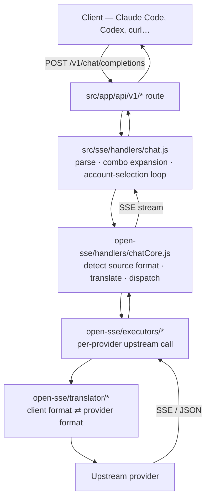

# 🏗️ Vela Architecture

> *"Follow one request from the harbor gate to the open sea — and every deck
> it crosses on the way. This chart covers the request lifecycle, the
> translator engine, the provider registry, the database layer, and the
> systems that keep the ship afloat."*

**Covers:** request lifecycle · translator engine · provider registry ·
executors (including the CodeBuddy family) · combos & fallback · breaker ·
scheduler · consent · RTK token saver · database layer · storage postures &
the mirror · backup engine · pricing covenant · authentication & security ·
the systems around the ship · directory map.

**Fleet:** [README.md](./README.md) (the harbor map) ·
[VERSIONING.md](./VERSIONING.md) (the release rite). Every count below was
measured **2026-10-28 at v1.2.5** and carries its derivation inline.

---

## Table of Contents

- [🗺️ The Shape of the Ship](#-the-shape-of-the-ship)
- [🔄 Request Lifecycle](#-request-lifecycle)
- [🈳 The Translator Engine](#-the-translator-engine)
- [🌐 The Provider Registry](#-the-provider-registry)
- [⚙️ Executors](#-executors)
- [🪂 Combos & Fallback](#-combos--fallback)
- [🐚 The RTK Token Saver](#-the-rtk-token-saver)
- [🗄️ The Database Layer](#-the-database-layer)
- [🪞 Storage Postures & The Mirror](#-storage-postures--the-mirror)
- [🗝️ The Backup Engine](#-the-backup-engine)
- [💰 The Pricing Covenant](#-the-pricing-covenant)
- [🔐 Authentication & Security](#-authentication--security)
- [🛟 The Systems Around the Ship](#-the-systems-around-the-ship)
- [🗂️ Directory Map](#-directory-map)
- [🔗 See Also](#-see-also)

---

## 🗺️ The Shape of the Ship

Vela is one Node.js process with three concerns:

| Layer | Where | What it does |
|-|-|-|
| **Dashboard + API** | `src/` (Next.js app) | Web UI, REST APIs, auth, settings — and the `/v1/*` gateway entry (a rewrite maps `/v1/*` → `/api/v1/*` in `next.config.mjs`) |
| **Routing engine** | `open-sse/` | Provider-agnostic translation + dispatch. Usable standalone; the app consumes it through thin glue |
| **Persistence** | `src/lib/db/` | SQLite by default, MariaDB twin or full mirror on demand, sealed backups |

The boundary between `src/sse/` (app-side entry glue) and `open-sse/` (the
engine) is deliberate. Cross it consciously. The MITM proxy (`src/mitm/`) sits
*outside* all three — a child process, off the request path, owned by the
systems tour at the foot of this chart.

---

## 🔄 Request Lifecycle

A chat completion is the canonical voyage:



Step by step:

1. **Entry** — `src/app/api/v1/chat/completions/route.js` receives the
   request. The model string may be plain (`gpt-5`) or prefixed
   (`kr/claude-sonnet-4.5`) — the prefix names the provider lane.
2. **Combo expansion** — if the model is a *combo*, `src/sse/handlers/chat.js`
   expands it into its ordered model list. The handler then runs the
   account-selection loop: for each candidate model, pick the account to try.
3. **Core dispatch** — `open-sse/handlers/chatCore.js` detects the incoming
   format (OpenAI / Claude-native), translates the request, dispatches to the
   executor, and owns retry + token-refresh on 401/expired credentials.
4. **Execution** — the executor makes the upstream call. `default.js` handles
   any OpenAI-compatible provider; specialized executors speak binary or
   bespoke protocols (see [Executors](#-executors)).
5. **Response** — streamed SSE (or JSON) flows back through the translator,
   which rewrites it into the client's format. Usage accounting records
   tokens + estimated cost on the way out.

Other surfaces share the same bones: `embeddings`, `audio/*` (tts/stt),
`images/generations`, `videos/*`, `responses`, `search`, and `web/fetch` each
have a handler in `src/sse/handlers/` paired with a core in
`open-sse/handlers/` (`embeddingsCore.js`, `ttsCore.js`, `sttCore.js`,
`imageGenerationCore.js`, `videoCore.js`, `responsesHandler.js`, and the
STT/live-audio cores).

> 🧭 **The shape the reader should carry:** `src/` decides *who may ask and
> which model answers*; `open-sse/` decides *what that answer looks like on the
> wire*. Nothing in `src/` speaks a provider's dialect, and nothing in
> `open-sse/` reads a client's key.

---

## 🈳 The Translator Engine

`open-sse/translator/` converts between wire formats by pivoting through
**OpenAI as the intermediate format**:

```
Claude request → OpenAI intermediate → provider format
provider response → OpenAI intermediate → Claude response
```

Three laws govern the engine:

1. **Direct routes skip the pivot.** A translator registered on an exact
   `source:target` pair (e.g. `claude:kiro`) runs as a direct route, avoiding
   the lossy double-hop. Prefer a direct route for fragile pairs — thinking
   blocks, tool ids, non-base64 images, `is_error` flags.
2. **Translators self-register** via `register(from, to, reqFn, resFn)` as an
   import side effect. ⚠️ A new translator file MUST be imported in
   `open-sse/translator/index.js` — or, for the test matrix,
   `registerAll.js` — or it never runs.
3. **Nothing hardcoded.** Roles, block types, and model strings come from
   `open-sse/translator/schema/` and `open-sse/config/` constants.
   Config-driven and DRY is enforced by convention here.

The test side of this engine has its own paper —
[tests/translator/AGENTS.md](../tests/translator/AGENTS.md) — which names the
`registerAll` requirement and the `it.fails` bug-exposure convention. Read it
before touching a translator; a provider added to the registry is covered by
the matrix automatically.

---

## 🌐 The Provider Registry

`open-sse/providers/registry/` — **one file per provider.** Measured
**2026-10-28 at v1.2.5**:

| # | Count | What it means | Derive |
|-|-|-|-|
| **189** | files on disk | every provider entry anyone has written | `ls open-sse/providers/registry/*.js \| grep -v index.js \| wc -l` |
| **186** | modules the generated index imports | the ones the app can even see | `node -e "import('./open-sse/providers/registry/index.js').then(m=>console.log(m.default.length))"` |
| **145** | dialable chat transports | entries with a `transport` block — the ones a request can reach | `node -e "import('./open-sse/providers/index.js').then(m=>console.log(Object.keys(m.PROVIDERS).length))"` |

The arithmetic closes, and it is worth reading why:

- **189 → 186: three files are hidden by a named, deliberate cull** —
  `devin-cli`, `trae`, `windsurf`. The generated index says so in its own
  header: *"Census: 186 imported providers (+ 3 hidden…)"*. 189 − 3 = 186.
- **186 → 145: forty-one imported entries legitimately carry no chat
  transport.** They are the media, search, and embedding services — TTS, image,
  STT, search, voice — which land in `PROVIDER_MEDIA` (103 ids at this
  measurement) and are dispatched by their own handlers. 186 − 41 = 145.

Neither subtraction is drift; both are designed. See
[PROVIDERS.md](./PROVIDERS.md) for the count discipline in full.

- `registry/index.js` is an **auto-generated** static import list
  (`scripts/generate-registry-index.mjs`). Regenerate it — never hand-edit.
- Adding a provider: copy `open-sse/providers/REGISTRY_TEMPLATE.js`, add its
  models to `open-sse/config/providerModels.js`, and (only if the upstream is
  NOT OpenAI-compatible) add an executor. Regenerate the index afterwards or
  the new file is invisible.
- Each registry file declares: id, aliases, auth style, endpoints, models, and
  display metadata. Aliases matter — they key the pricing overrides and the
  `provider/model` addressing.

---

## ⚙️ Executors

`open-sse/executors/` — the per-provider upstream call layer. Measured
**2026-10-28**: **43 `.js` files**, of which **40** sit beyond the
`base.js` / `default.js` / `index.js` trio.

```bash
ls open-sse/executors/*.js | wc -l                                        # 43
ls open-sse/executors/*.js | grep -vE '/(base|default|index)\.js$' | wc -l   # 40
```

> 🧭 **Name the unit.** `ls open-sse/executors/*.js` counts *files*; the
> upstream call for a family of products may be **one** file (see the CodeBuddy
> family below) even though it answers for four providers. A directory inside
> the folder (`chatgpt-web/`, `gemini-web/`, `muse-web/`, `deepseek-web/`) is
> not a file and will not appear in that count.

- **`default.js`** handles any OpenAI-compatible provider. Most providers
  never need anything else.
- **Specialized executors** exist where the upstream speaks a non-OpenAI
  protocol: `azure.js`, `vertex.js`, `codex.js`, `cursor.js`, `kiro.js`,
  `gemini-cli.js`, `grok-web.js`, `perplexity-web.js`, `ollama-local.js`, and
  many more. `executors/index.js` exposes them through `getExecutor(provider)`
  and `hasSpecializedExecutor(provider)`.
- ⚠️ Binary/protobuf upstreams (Kiro EventStream, Cursor protobuf,
  CommandCode NDJSON) **do not round-trip through the translator** — they are
  handled inside their own executor.

### The CodeBuddy family — one hull, four shores

`open-sse/executors/codebuddy-family.js` serves **four products through one
class over one frozen table**: `codebuddy-cn` (`copilot.tencent.com`),
`codebuddy-intl` (`www.codebuddy.ai`), `workbuddy-cn` (`www.workbuddy.cn`),
and `workbuddy-intl` (`www.workbuddy.ai`). Profiles live in
`open-sse/shared/codebuddy/profiles.js`.

The design law, from the module's own header: **the class never asks which
product it is serving.** Every difference between the four — opener,
message shape, system-text sanitising, console-door fallback, host — is a
*field* on the profile, never a branch on an id. A fifth sibling would cost one
object and no new code. No request state lives on `this`: executors are
module-load singletons, so an instance field is shared by every concurrent
request — the deleted `_forcedUrl` was not only a race but a permanent hijack.

Four systems ride inside this family, each verified in
`open-sse/shared/codebuddy/`:

| System | File | What it guarantees |
|-|-|-|
| **The honest gate** | `gate.js` | CodeBuddy refuses inside HTTP 200 in three shapes (JSON body, first SSE frame, mid-stream frame). The gate catches all three so a refusal becomes an honest 4xx and combo fallback fires |
| **The content filter** | `contentFilter.js` | A sensitivity block arrives as a canned apology with `finish_reason: "stop"`; a **pure** refusal becomes a 400, an impure one is never double-spent |
| **The capability gate** | `capabilityGate.js` | Refuses *before* the upstream call, stays silent until a catalogue fills its seam (never guessing), and keeps the refusal request-scoped so an account is never cooled for a body it did not cause |
| **The channel check** | `channelCheck.js` | Detects an unapproved-channel refusal and chooses the console-door fallback per request |

---

## 🪂 Combos & Fallback

Two fallback mechanisms, applied in order by the account-selection loop in
`src/sse/handlers/chat.js`:

| Mechanism | What it does |
|-|-|
| **Model combos** | A combo is an ordered list of models. Vela tries them in sequence until one succeeds — subscription → cheap → free is the classic shape |
| **Multi-account fallback** | Several credential sets per provider; rotation spreads load and routes around per-account rate limits |

When an executor reports an auth failure, `chatCore.js` attempts a token
refresh before falling back. Quota exhaustion moves the loop to the next
candidate.

Two further laws sit *beside* the loop, not inside it:

- **Fallback rules** (`fallbackRules`, migration `012`) — per-source-model
  rules bound to the combo path through `bindFallbackRules.js`. They are a
  database-backed layer with their own table; see the
  [caveat below](#-the-database-layer) about that table's absence from
  `TABLES`.
- **The circuit breaker** — when a credential fails terminally in a row, the
  breaker opens and the executor answers a synthetic `429`, so account
  selection rotates instead of hammering a dead credential.

### The persistent circuit breaker

`open-sse/shared/codebuddy/breakerStore.js` + `breakerBinding.js` — the
breaker's open windows survive a restart, bound at boot from
`src/instrumentation.js` (fire-and-forget, never on the request path;
degrading to memory-only if binding fails).

The in-memory `Map` inside `gate.js` remains the truth the request path reads;
the bound store is where it remembers. Five laws make a persisted breaker
safe, carried verbatim from the reference gateway:

1. **A restored deadline can never sit further out than its ceiling** — every
   deadline is clamped at read time; expired, non-finite, or over-ceiling rows
   are discarded, never repaired.
2. **The reader accepts only a wholly valid snapshot** — one malformed row
   discards the document; a half-understood file is worse than none.
3. **Storage failure degrades to memory, never to lockout** — a breaker that
   cannot write must still admit traffic.
4. **The write is bounded** — past the byte cap, rows nearest expiry are shed,
   and the caller whose row was shed is told.
5. **Per credential, not per model** — the grain the executors actually key on.

A channel refusal (CodeBuddy business code `11128`, moderation) or any body-refused 4xx is recorded as *answered*,
not as a fault — so a body-level refusal never cools an account. See
[gate.js](../open-sse/shared/codebuddy/gate.js) and
[breakerStore.js](../open-sse/shared/codebuddy/breakerStore.js).

### Scheduler modes

`open-sse/shared/codebuddy/routingScheduler.js` — revision-keyed credential
shards. Selecting a credential answers a mostly static question ("which
accounts are eligible for this model?") that only changes when the credential
set or its revisions change; the shard caches the answer. **Three modes, all
explicit** because a cache that changes behaviour is not an optimisation:

| Mode | Behaviour |
|-|-|
| `legacy` | evaluate the predicate every request; no shard is ever built |
| `shadow` | build and serve the shard, but return the legacy answer and count disagreements — **the default** |
| `indexed` | serve the shard |

Two disciplines ride along: a shard is keyed by **revisions, not time** (a
stale shard is unreachable rather than expired), and **dynamic health is never
cached** — cooldowns, breakers, and rate windows are re-checked live. An
unrecognised mode string falls back to `shadow`, never to `indexed`.

---

## 🐚 The RTK Token Saver

`open-sse/rtk/` — pre-translate hooks that compress `tool_result` content
in-place, cutting the tokens that tool output (diffs, grep results, file
listings) burns before the request even leaves.

Two invariants:

- **Fail-open.** Any error returns `null` and leaves the body untouched —
  the hooks never throw.
- **Traces preserved.** Results flagged `is_error` / `status: "error"` are
  skipped so debugging traces survive intact.

The optional **Headroom** sidecar (separate Python service, reached through
`HEADROOM_URL` / `src/lib/headroom/detect.js`) provides deeper request
compression; it never ships inside the Vela image — see
[DOCKER.md](../DOCKER.md).

---

## 🗄️ The Database Layer

State lives in SQLite — **not** `db.json` (that era is over). The layer sits
under `src/lib/db/`:

**Driver chain** (`driver.js`) — first that loads wins:
`bun:sqlite` → `better-sqlite3` (optional native dep) → `node:sqlite`
(Node ≥ 22.5) → `sql.js` (pure-JS fallback, always works).
`better-sqlite3` sits in `optionalDependencies` so install never fails
without build tools.

**Facades** — `src/lib/db/repos/*.js` are path-stable entry points. Each
facade binds by posture: sqlite re-exports its harbor verbatim; mysql binds
the `repos/mysql/` twin. `src/lib/localDb.js` is a backward-compat shim —
new code imports `@/lib/db/index.js`.

**Schema** — `src/lib/db/migrations/` runs **23** migrations
(`001-initial` → `023-plans`); `SCHEMA_VERSION = 23`. At v1.2.5, measured
2026-10-28:

```bash
grep -n 'SCHEMA_VERSION' src/lib/db/schema.js                      # 23
ls src/lib/db/migrations/*.js | grep -v index.js | wc -l           # 23 — one file per version
```

`src/lib/usageDb.js` is a **shim** re-exporting the DB layer — usage and
request logs live in the SQLite harbor, and the whole tree resolves from
`DATA_DIR`.

> ⚠️ **Not every table is in `TABLES`.** `fallbackRules` is born of migration
> `012` (its v2 columns from `014`) and is **absent** from the `TABLES` source
> of truth — so the additive sync CANNOT supply its columns and the versioned
> chain **must** run. Check before assuming `TABLES` covers a table.

**DB file location** — `src/lib/db/paths.js`: `DATA_DIR` if set, else
`~/.vela/`.

---

## 🪞 Storage Postures & The Mirror

`VELA_DB_MODE` selects the harbor:

| Posture | Behavior |
|-|-|
| `sqlite` | Single-store, exactly today. The default |
| `mysql` | MariaDB IS the harbor. An unreachable twin refuses boot **LOUD** — never silent |
| `mirror` | SQLite PRIMARY serves every read/write; writes mirror to the MariaDB twin through the outbox pump |

The mirror's machinery (Storage Covenant, waves C1–C5):

```
write → outbox capture (decorator) → pump → MariaDB twin
                                  ↘ poison policy after retry budget
divergence sweep (interval) → threshold breach → full resync
usage rows → watermark resync (separate rhythm, batched)
```

A down twin **degrades** the mirror — it never silently downgrades the mode.
All tuning knobs are documented in [ENVIRONMENT.md](./ENVIRONMENT.md).

---

## 🗝️ The Backup Engine

Opt-in (`VELA_BACKUP_ENABLED=true`), sealed with AES-256-GCM:

- Scheduled artifacts with retention tiers (daily + weekly)
- Restore flow + restore **drill** (`/api/backup/drill`) — rehearse before you need it
- Optional S3 off-site leg (SigV4, dependency-free)
- ⚠️ `VELA_BACKUP_ENCRYPTION_KEY` loss = permanently unrecoverable backups

The purge (`VELA_USAGE_RETENTION_DAYS`) runs AFTER the scheduled backup so
purged rows live in the artifact. Full detail: [STORAGE.md](./STORAGE.md).

---

## 💰 The Pricing Covenant

Estimated cost per request, resolved through a static chain in
`open-sse/providers/pricing.js` (first match wins):

1. `UNPRICEABLE` manifest — router pseudo-models resolve `null` + reason
2. `PROVIDER_PRICING[id|alias][model]` — provider-lane overrides
3. `MODEL_PRICING[model]` — canonical exact match
4. `FREE_ALIAS_MAP[model]` — free models inherit the paid sibling's exact
   rate (guarded suffix-strip fallback; denylist blocks router traps)
5. `MODEL_PRICING[stripVendor(model)]` — vendor-prefix stripped
6. `PATTERN_PRICING` — pre-compiled globs, last resort

Async layers sit above the chain: user overrides (scope `pricing`) and
models.dev sync (scope `pricing_sync`) in `src/lib/db/repos/pricingRepo.js`.
A model that matches nothing resolves `null` → est. cost shows $0. Add its
rate or a pattern to fix.

> 🧭 **The covenant's honesty is in the sixth step.** `null` is an answer, not
> an error: an unpriced model says "I do not know" rather than guessing a
> number and billing a fiction to the ledger.

---

## 🔐 Authentication & Security

- **Session** — JWT cookie (`JWT_SECRET`). The Vela session cookie name is
  separate from upstream (pre-Vela). Sessions are listable and revocable
  (`/api/auth/sessions`, `/api/auth/sessions/revoke-all`).
- **First login** — there is **no default password**. The old `123456` was
  retired: with `INITIAL_PASSWORD` unset, the local console admits a loopback
  request without one but **refuses remote logins** until a password is set.
  Password reset is its own route (`/api/auth/reset-password`).
- **Dashboard SSO — OIDC and SAML.** Both are first-class, each with a
  start route, a callback/ACS route, a discovery/metadata route, and a **test**
  route (verified 2026-10-28 at v1.2.5):

  | Realm | Routes under `src/app/api/auth/` |
  |-|-|
  | OIDC | `oidc/start` · `oidc/callback` · `oidc/test` |
  | SAML | `saml/start` · `saml/acs` · `saml/metadata` · `saml/test` |

  The `test` routes exist so an operator proves the identity provider answers
  *before* locking the console behind it — the only honest way to enable SSO.
- **API keys** — per-endpoint keys hashed with `API_KEY_SECRET`; machine id
  salted with `MACHINE_ID_SALT`.
- **Client IP** — `custom-server.js` wraps the Next standalone server to
  derive the client IP from the **TCP socket** and strips attacker-controlled
  `X-Forwarded-For`, trusting forwarding headers only from a loopback reverse
  proxy. Preserve this when touching request/IP/rate-limit code.
- **Backup routes** are always auth-protected; settings redaction masks
  secret keys in API responses (see STORAGE.md). Settings PATCH refuses
  privileged keys such as `mitmSudoEncrypted` — the proxy's privileged bits
  are not dashboard-writable (see [API.md](./API.md)).

---

## 🛟 The Systems Around the Ship

Four smaller machines keep the harbor running. None of them is on the request
path, and all of them have bitten someone who assumed they were automatic.

### The icon subset

Material Symbols ships as a 3.96MB variable font covering 4,277 icons. Vela
uses a **GSUB-pruned subset** — currently **260 icons** in
`scripts/icon-ligatures.txt`, emitted as
`public/fonts/vela-icons.<sha16>.woff2` and named by the hash of its sorted
inventory, so the URL changes only when the glyph set changes (a browser cache
can never serve an old subset as new). `src/app/globals.css` carries the
`@font-face` pointing at it. Derive the inventory size with
`grep -vc '^#\|^$' scripts/icon-ligatures.txt`.

- **The failure mode is silent.** An icon name outside the inventory does not
  error — the ligature simply never forms and the raw word (`table_rows`)
  renders as text beside the real glyphs. `tests/unit/icon-subset.test.js`
  scans every named literal in `src/` against the inventory file.
- **Adding an icon** means adding the name to `scripts/icon-ligatures.txt` and
  re-running `python3 scripts/subset-icons.py` (needs `fonttools` + `brotli`;
  it fetches the codepoint map once into `assets-tmp/ms.codepoints`). The forge
  prunes GSUB, subsets, renames by content hash, repoints `globals.css`, and
  prunes the previous font — all in one pass.

### The served changelog

The dashboard's Changelog modal reads the log from the gateway itself
(`public/CHANGELOG.md`), not from GitHub's raw endpoint — no rate limit, no
network, and it survives a visibility change. The root `CHANGELOG.md` stays the
source of truth; `scripts/sync-changelog.mjs` copies it to `public/` on every
dev startup and before every build, and `postbuild` carries `public/` into the
standalone output.

### The updater

`src/lib/updater*` checks for a newer release and, on the npm/CLI berth, offers
an in-place update (`Sidebar`'s update modal, confirmed through the shared
`ConfirmModal`). The Docker berth updates by pulling a new tag — see
[DEPLOYMENT.md](./DEPLOYMENT.md) and [VERSIONING.md](./VERSIONING.md).

### The MITM proxy

`src/mitm/` is a **child process**, not part of the request path: it exists for
the tools that insist on speaking to a real host over TLS (the Antigravity and
Kiro-class transports). It is opt-in per tool and carries its own lifecycle.
`mitmSudoEncrypted` is one of the keys the settings PATCH **refuses** (see
[API.md](./API.md)) — the proxy's privileged bits are not dashboard-writable.

### The consent gate

`open-sse/shared/codebuddy/consent.js` gates the CodeBuddy automation lane —
actions that cost a *real* account something (a daily check-in, a dispatched
Buddy, a growth task). Its four laws:

1. **Consent is a revision, not a boolean.** The hash of the exact terms shown
   is the consent; change the terms and every prior acceptance is void.
2. **The presented revision must match exactly.** A caller that does not echo
   the current revision is refused, not helped.
3. **Consent is not queued work.** A prior action is superseded, not run — no
   consent, no spend.
4. **The audit precedes the write.** The record lands *before* the effect, so
   a crash leaves evidence of intent rather than a silent grant.

The module deliberately calls no upstream: it decides whether a human said yes
to exactly these words. The doing stays behind the caller's own switch, which
the Star arms — never this file.

---

## 🗂️ Directory Map

```
src/
├── app/                 Next.js app — 36 pages, 258 API routes (2026-10-28)
│   ├── (dashboard)/     dashboard UI pages
│   ├── api/             REST APIs — auth (incl. oidc/, saml/), backup, combos,
│   │                    keys, models, oauth, pricing, providers, settings,
│   │                    usage, headroom, v1/*
│   └── api/v1/          the gateway surface (reached via the /v1 rewrite)
├── sse/handlers/        app-side entry glue for the engine
└── lib/
    ├── db/              driver chain, adapters, migrations (23), mirror
    │   ├── migrations/  001-initial … 023-plans
    │   └── repos/       facades + sqlite/mysql implementations
    ├── headroom/        sidecar detection (never shipped in the image)
    └── usageDb.js       shim → re-exports the DB layer's usage surface

open-sse/
├── handlers/            chatCore, embeddingsCore, ttsCore, imageGenerationCore, …
├── executors/           43 .js files — base/default/index + 40 specialized
│   ├── codebuddy-family.js   one class, four products (cn/intl × codebuddy/workbuddy)
│   └── {chatgpt-web,gemini-web,muse-web,deepseek-web}/   in-executor helpers
├── shared/codebuddy/    gate · breaker store/binding/ledger · profiles ·
│                        capabilityGate · contentFilter · channelCheck ·
│                        routingScheduler · consent · identity · siteRouting
├── translator/          format translation (OpenAI pivot + direct routes)
├── providers/           registry (189 files) + pricing.js + REGISTRY_TEMPLATE.js
├── rtk/                 token saver hooks
├── config/              providerModels + shared constants
└── AGENTS.md            ← engine contributor guide

cli/                     launcher package (npm: vela)
docs/                    these charts
gitbook/                 the published docs site (tracked, 5 languages)
plans/                   sealed design plans (ADR-style, gitignored)
skills/                  drop-in agent skills
tests/                   vitest suite — 480 files (460 .test.js + 19 .test.jsx
                         + 1 .test.cjs outside the config's include glob)
```

Derivation commands for every figure above live in
[README.md § Where to Find a Number](./README.md#-where-to-find-a-number).

---

## 🔗 See Also

- [STORAGE.md](./STORAGE.md) — the Storage Covenant in full
- [API.md](./API.md) — the endpoint surface
- [PROVIDERS.md](./PROVIDERS.md) — the provider roster and the count discipline
- [open-sse/AGENTS.md](../open-sse/AGENTS.md) — how to add a provider / executor / translator
- [tests/translator/AGENTS.md](../tests/translator/AGENTS.md) — the translation matrix
- [VERSIONING.md](./VERSIONING.md) — the release rite
- [README.md](./README.md) — the harbor map
- [../CLAUDE.md](../CLAUDE.md) — the crew's papers

— *Vela · The Sail of the Ship* ⛵
