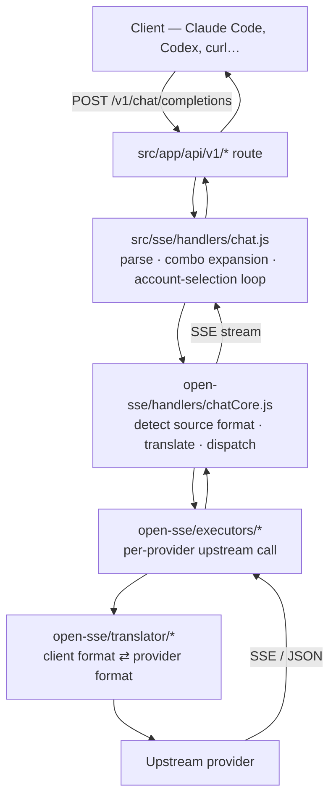

# 🏗️ Vela Architecture

> *"Follow one request from the harbor gate to the open sea — and every deck
> it crosses on the way. This chart covers the request lifecycle, the
> translator engine, the provider registry, the database layer, and the
> systems that keep the ship afloat."* 🪞💜

**Covers:** request lifecycle · translator engine · provider registry ·
executors · combos & fallback · circuit breaker · RTK token saver · prompt
injectors · database layer · storage postures · mirror machinery · backup
engine · pricing covenant · security boundaries · failure-mode catalog.

---

## Table of Contents

- [The Shape of the Ship](#-the-shape-of-the-ship)
- [Request Lifecycle](#-request-lifecycle)
- [The Translator Engine](#-the-translator-engine)
- [The Provider Registry](#-the-provider-registry)
- [Executors](#-executors)
- [Combos & Fallback](#-combos--fallback)
- [Fallback Rules v2 — The Condition Builder](#-fallback-rules-v2--the-condition-builder)
- [The Circuit Breaker](#-the-circuit-breaker)
- [The RTK Token Saver](#-the-rtk-token-saver)
- [Prompt Injectors v2](#-prompt-injectors-v2)
- [The Database Layer](#-the-database-layer)
- [Storage Postures & The Mirror](#-storage-postures--the-mirror)
- [The Backup Engine](#-the-backup-engine)
- [The Pricing Covenant](#-the-pricing-covenant)
- [Authentication & Security](#-authentication--security)
- [The Failure-Mode Catalog](#-the-failure-mode-catalog)
- [Directory Map](#-directory-map)
- [See Also](#-see-also)

---

## 🗺️ The Shape of the Ship

Vela is one Node.js process with three concerns:

| Layer | Where | What it does |
|-|-|-|
| **Dashboard + API** | `src/` (Next.js app) | Web UI, REST APIs, auth, settings — and the `/v1/*` gateway entry (a rewrite maps `/v1/*` → `/api/v1/*` in `next.config.mjs`) |
| **Routing engine** | `open-sse/` | Provider-agnostic translation + dispatch. Usable standalone; the app consumes it through thin glue |
| **Persistence** | `src/lib/db/` | SQLite by default, MariaDB twin or full harbor on demand, sealed backups |

The boundary between `src/sse/` (app-side entry glue) and `open-sse/` (the
engine) is deliberate. Cross it consciously: app-side handlers orchestrate
(combos, account selection, gates); engine-side cores translate and dispatch.

---

## 🔄 Request Lifecycle

A chat completion is the canonical voyage:



Step by step:

1. **The helm** — `custom-server.js` wraps Next's standalone output: derives
   the client IP from the **TCP socket** (unspoofable), strips the RFC 7230
   §6.1 hop-by-hop set from client headers, downgrades h2c (JBR 25) to
   HTTP/1.1 with a **512 MB body guard**, and drains gracefully on SIGTERM.
2. **Entry** — `src/app/api/v1/chat/completions/route.js` receives the
   request. The model string may be plain (`gpt-5`) or prefixed
   (`kr/claude-sonnet-4.5`) — the prefix names the provider lane.
3. **The gates** — `keyGate.js` authorizes the API key against its per-key
   ACL (kinds / providers / combos / models, tri-state), then
   `budgetGate.js` enforces daily/spend caps.
4. **Combo expansion** — if the model is a *combo*, `src/sse/handlers/chat.js`
   expands it into its ordered model list. The handler then runs the
   account-selection loop: for each candidate model, consult the circuit
   breaker (`isAvailable`) and the fallback rules, then pick the account to try.
5. **Core dispatch** — `open-sse/handlers/chatCore.js` detects the incoming
   format (OpenAI / Claude-native / Responses), applies the RTK savers,
   translates the request, dispatches to the executor, and owns retry +
   token-refresh on 401/expired credentials.
6. **Execution** — the executor makes the upstream call. `default.js` handles
   any OpenAI-compatible provider; specialized executors speak binary or
   bespoke protocols (see [Executors](#-executors)).
7. **Response** — streamed SSE (or JSON) flows back through the translator,
   which rewrites it into the client's format. Usage accounting records
   tokens + estimated cost on the way out.

Other surfaces share the same bones: `embeddings`, `audio/*` (tts/stt),
`images/generations`, `videos/*`, `responses`, `search`, and `web/fetch`
each have a handler in `src/sse/handlers/` paired with a core in
`open-sse/handlers/`.

### The seam between the two engines

```
src/sse/handlers/chat.js            open-sse/handlers/chatCore.js
┌──────────────────────────┐        ┌───────────────────────────────┐
│ parse model string       │ ─────▶ │ detect source format          │
│ expand combos            │  calls │ apply RTK savers              │
│ run account loop         │        │ translateRequest              │
│ consult breaker + rules  │        │ dispatch to executor          │
│ own budget/quota gates   │        │ own retry + token refresh     │
└──────────────────────────┘        └───────────────────────────────┘
```

---

## 🈳 The Translator Engine

`open-sse/translator/` converts between wire formats by pivoting through
**OpenAI as the intermediate format**:

```
Claude request → OpenAI intermediate → provider format
provider response → OpenAI intermediate → Claude response
```

Three laws govern the engine:

1. **Direct routes skip the pivot.** A translator registered on an exact
   `source:target` pair (e.g. `claude:kiro`) runs as a direct route,
   avoiding the lossy double-hop. Prefer a direct route for fragile pairs —
   thinking blocks, tool ids, non-base64 images, `is_error` flags.
2. **Translators self-register** via `register(from, to, reqFn, resFn)` as
   an import side effect. ⚠️ A new translator file MUST be imported in
   `open-sse/translator/index.js` or it never runs.
3. **Nothing hardcoded.** Roles, block types, and model strings come from
   `open-sse/translator/schema/` and `open-sse/config/` constants.
   Config-driven and DRY is enforced by convention here.

**Layout:**

```
translator/
├── index.js          the registry/entry — every file must be imported here
├── formats/          per-format knowledge: openai.js, claude.js, gemini.js,
│                     responsesApi.js, maxTokens.js
├── request/          <from>-to-<to>.js request converters
├── response/         <from>-to-<to>.js response converters
├── schema/           enums: ROLE, CLAUDE_BLOCK, …
└── concerns/         shared logic across converters
```

**The pivot trade-off, honestly stated:** pivoting through OpenAI is lossy
for fragile constructs — thinking blocks, tool ids, non-base64 images,
`is_error` flags. Direct routes exist precisely for those pairs; the
translator registry resolves the exact `source:target` pair first, and only
falls back to the pivot when no direct route is registered.

---

## 🌐 The Provider Registry

`open-sse/providers/registry/` — **one file per provider, 126 files** (v0.9.23).

- `registry/index.js` is an **auto-generated** static import list.
  Regenerate with `scripts/migrate-registry.mjs` /
  `injectDisplayToRegistry.mjs` — never hand-edit.
- Adding a provider: copy `open-sse/providers/REGISTRY_TEMPLATE.js`, add its
  models to `open-sse/config/providerModels.js`, and (only if the upstream is
  NOT OpenAI-compatible) add an executor.
- Each registry file declares: id, aliases, auth style, endpoints, models,
  and display metadata. Aliases matter — they key the pricing overrides and
  the `provider/model` addressing.

**Provider categories** (from the dashboard's groupings): subscription lanes
(Claude, Codex, Copilot, Cursor), pay-per-use (GLM, MiniMax, DeepSeek,
Qwen), free tiers (Kiro, OpenCode Free, MiMo Free), plus search, voice,
image, and video fleets. The full roster: [PROVIDERS.md](./PROVIDERS.md).

---

## ⚙️ Executors

`open-sse/executors/` — the per-provider upstream call layer.

- **`base.js`** — `BaseExecutor`; every executor extends it.
- **`default.js`** handles any OpenAI-compatible provider. Most providers
  never need anything else.
- **Specialized executors** exist where the upstream speaks a non-OpenAI
  protocol: `azure.js`, `vertex.js`, `codex.js`, `cursor.js`, `kiro.js`,
  `gemini-cli.js`, `grok-cli.js`, `grok-web.js`, `perplexity-web.js`,
  `ollama-local.js`, `qoder.js`, `iflow.js`, `trae.js`, `windsurf.js`,
  `zed.js`, `opencode.js`, `devin-cli.js`, `antigravity.js`,
  `commandcode.js`, `github.js`, `kimchi.js`, `mimo-free.js`, `freebuff.js`,
  `codebuddy-cn.js`, `codebuddy-intl.js`, `xiaomi-tokenplan.js`,
  and more (~29 total).
- ⚠️ Binary/protobuf upstreams (Kiro EventStream, Cursor protobuf,
  CommandCode NDJSON) **do not round-trip through the translator** — they are
  handled inside their own executor.

**The executor contract:** an executor receives the translated request, makes
the upstream call (streaming or buffered), and yields chunks in the provider's
native shape; the response translator rewrites them to the client format.
On auth failure it signals the core, which attempts token refresh before
falling back.

---

## 🪂 Combos & Fallback

The fallback stack (v0.9.23), applied in order by the account-selection loop:

| Mechanism | Where | What it does |
|-|-|-|
| **Model combos** | `open-sse/services/combo.js` | A combo is an ordered list of models. Vela tries them in sequence until one succeeds — subscription → cheap → free is the classic shape |
| **Fallback rules v2** | `open-sse/services/fallbackRuleMatcher.js` + `fallbackRulesRepo` | Operator rules with typed triggers (next section) |
| **Circuit breaker** | `src/lib/network/circuitBreaker.js` | Cooldown → exhausted escalation with exponential backoff; woven into pool selection |
| **Multi-account fallback** | `open-sse/services/accountFallback.js` | Several credential sets per provider; round-robin rotation spreads load and routes around per-account rate limits |

When an executor reports an auth failure, `chatCore.js` attempts a token
refresh before falling back. Quota exhaustion moves the loop to the next
candidate.

**The combo loop, in detail:**

```
for each model in rotation list:
    breaker.isAvailable(pool, provider, model) ?  → try the lane
    on failure: record lastStatus / lastError / timedOut
    if fallback rules enabled:
        chain = buildFallbackChain(rules, { status, errorText, timedOut })
        appendChain(chain)   # DB targets join AFTER the failed model
    next candidate
```

---

## 🎯 Fallback Rules v2 — The Condition Builder

Migration `014-fallback-rules-v2-triggers` added the typed-trigger surface:
`triggerType`, `conditionOp`, `conditionVal`, `targetModels` (JSON chain),
`cooldownSkip` — on top of the v1 shape (`name`, `isActive`, `priority`,
`sourceModel`, `targetModel`, `triggerOnStatus`).

### The matcher engine — `open-sse/services/fallbackRuleMatcher.js`

Pure, side-effect-free, unit-tested (12 tests). Two exported functions:

- **`ruleMatches(rule, event)`** — does this rule's trigger fire for this event?
- **`buildFallbackChain(rules, event)`** — which target models, in which order?

### The typed triggers

| Trigger | Condition shape | When it fires |
|-|-|-|
| `status` | `conditionVal` CSV (default `429,503`) | The upstream returned a listed HTTP status |
| `contentPolicy` | — | 400/403 **with** policy language ("content policy", "content filter", …) |
| `contextWindow` | `conditionOp` (`gte`/`lte`) × `conditionVal` ratio | **Pre-call** — see below |
| `timeout` | — | The upstream call timed out |
| `anyError` | — | Every failure |

### Pre-call context-window detection

The standout of v2: `combo.js` estimates input tokens before dispatch
(chars/4 estimator) and compares against
`getCapabilitiesForModel().contextWindow`. A `contextWindow` rule whose
ratio condition is met expands **before** the upstream call — the doomed
request never leaves the harbor.

```
estimate tokens ≈ chars / 4
ratio = estimate / contextWindow
rule condition: ratio gte|lt threshold  →  expand chain pre-call
```

### Chain semantics

- `targetModels[]` (JSON) is an **ordered multi-hop chain** — expanded in
  priority order (lower `priority` first), deduped. A→B→C chains are native.
- **v1 back-compat:** absent `isActive` = active; absent
  `conditionVal`/`triggerOnStatus` defaults to `429,503`; a v1 rule with only
  `targetModel` + `triggerOnStatus` keeps firing exactly as before.
- **Per-request opt-out:** `"vela_disable_fallback_rules": true` in the body.
- **Fail-open:** a DB error resolves `null` → the combo proceeds
  byte-identical to "no rules configured". Optional subsystems never break
  the request.
- **Cooldown-skip:** `cooldownSkip` is schema+UI metadata today; the
  breaker-keyed skip at the combo layer is a documented future seam (the
  combo layer lacks pool context to key a breaker today).

### The bind — `src/lib/db/repos/bindFallbackRules.js`

Caches the repo-shaped facade used by the combo layer; keeps the sqlite /
mysql / mirror posture differences out of the engine.

---

## 🛡️ The Circuit Breaker

`src/lib/network/circuitBreaker.js` — a pool/provider/model-keyed state
machine that keeps a failing lane from cascading into every request.

| State | Meaning | Transition |
|-|-|-|
| **Healthy** | Normal operation | → cooldown on failure |
| **Cooldown** | Recent failure; requests for this key route around | → exhausted after repeated failures, or back to healthy on success |
| **Exhausted** | The lane is out of rotation | → exponential backoff, then probe |

**Public surface:** `isAvailable(poolId, providerId, model)` ·
`recordFailure` · `recordSuccess` ·
`onRetryAfter(poolId, providerId, model, ms)` (honors upstream
`retry-after`) · `getSnapshot()` (dashboard panel) · `resetKey` · `clearAll`
· `flushNow`.

**Woven into pool selection** (`src/lib/network/proxyFleet.js`):

```
pick(poolIds, policy)
  → resolveForConnection / resolveVirtualConnection
  → recordOutcome(poolId, providerId, signal)
  → recordClaimGate(poolId, providerId, code)
  → repick(model, excludePoolIds, maxAttempts, budgetMs)   # bounded re-pick
getFitnessSummary()  → dashboard pool health
```

**Pool egress geo** — `poolGeo.js` + `poolEgressProbe.js`: a shared egress
registry + background probe; the dashboard shows each pool's egress
IP/country/flapping.

---

## 🐚 The RTK Token Saver

`open-sse/rtk/` — pre-translate hooks that compress `tool_result` content
in-place, cutting the tokens that tool output (diffs, grep results, file
listings) burns before the request even leaves.

Two invariants:

- **Fail-open.** Any error returns `null` and leaves the body untouched —
  the hooks never throw.
- **Traces preserved.** Results flagged `is_error` / `status: "error"` are
  skipped so debugging traces survive intact.

### The filter chain

```
rtk/index.js ──> applyFilter.js ──> registry.js ──> autodetect.js
        │
        ├── caveman.js          terse-reply system injection
        ├── ponytail.js         YAGNI-first lazy-senior-dev prompt
        ├── pxpipe.js           image bulky-context compression (Claude bodies)
        ├── systemInject.js     built-in system-prompt savers
        ├── userInjectors.js    operator-defined prompts (v2 — below)
        └── headroom.js         external compress sidecar (HEADROOM_URL)
```

Settings (defaults in `src/lib/db/repos/settingsDefaults.js`):
`cavemanEnabled` / `cavemanLevel` · `ponytailEnabled` / `ponytailLevel` ·
`pxpipeEnabled` / `pxpipeMinChars` (25000) / `pxpipeTimeoutMs` (15000) ·
`headroomEnabled` / `headroomUrl`.

The optional **Headroom** sidecar (separate Python service,
`HEADROOM_URL`) provides deeper request compression; it never ships inside
the Vela image — see [DOCKER.md](../DOCKER.md). The dashboard's
`compress: false` is deliberate — the sidecar owns compression, never
double-gzip.

---

## 🎨 Prompt Injectors v2

`rtk/userInjectors.js` — operator-defined system prompts layered via
`injectSystemPrompt` (append/prepend) after the built-in savers.

**The variable map** — built-ins expanded at dispatch from live context:

| Variable | Source |
|-|-|
| `{{model}}` | The upstream model id |
| `{{kind}}` | Service kind (`llm`) |
| `{{date}}` / `{{time}}` | Today's date / current time |
| `{{keyPrefix}}` | First 7 chars of the API key |
| `{{requestId}}` | The connection id |
| `{{userAgent}}` | Client user-agent |

**Custom variables** — per-injector `injector.variables = { name: default }`,
overridable per-request via `x-vela-inject-var-<name>` headers
(case-insensitive). The header match is
`/^x-vela-inject-var-(.+)$/` on the lower-cased header name.

**Fail-safe expansion** — unresolved variables stay literal
(`{{unknown}}` passes through unchanged); expansion never crashes. The
`normalizeInjector` pass preserves the `variables` block.

**The pipeline position:** applied last, after the built-in savers, so
operator prompts layer over them; kind-gated (`applyTo` "llm" or "*").

---

## 🗄️ The Database Layer

State lives in SQLite — **not** `db.json` (that era is over). The layer sits
under `src/lib/db/`:

**Driver chain** (`driver.js`) — first that loads wins:
`bun:sqlite` → `better-sqlite3` (optional native dep) → `node:sqlite`
(Node ≥ 22.5) → `sql.js` (pure-JS fallback, always works).
`better-sqlite3` sits in `optionalDependencies` so install never fails
without build tools. `VELA_DB_DRIVER` pins one; a pin that cannot load is a
loud failure, not a silent fallback.

**Adapters** (`src/lib/db/adapters/`) — `betterSqliteAdapter`,
`nodeSqliteAdapter`, `bunSqliteAdapter`, `sqljsAdapter`. All expose
`run/get/all/exec/transaction`.

> **⚠️ THE ADAPTER CONTRACT (learned the hard way, v0.9.20):** the adapter
> interface exposes `run/get/all/exec/transaction` — **NO raw `prepare()`**.
> The sql.js adapter (Docker runner's fallback) and the mysql/mirror
> adapters have no public `.prepare`. A migration using `db.prepare(...)`
> crashed every DB API at boot (the 0.9.19 boot storm). **Use
> `db.all("PRAGMA table_info(...)")` + `db.exec(...)`** — exactly like
> migration 002 documents.

**Facades** — `src/lib/db/repos/*.js` are path-stable entry points. Each
facade binds by posture: sqlite re-exports its harbor verbatim; mysql binds
the `repos/mysql/` twin. `src/lib/localDb.js` is a backward-compat shim —
new code imports `@/lib/db/index.js`.

**Schema** — `src/lib/db/migrations/` runs **14 versioned migrations**
(`001-initial` → `014-fallback-rules-v2-triggers`); `SCHEMA_VERSION = 13`
in `src/lib/db/schema.js` (the pre-change backup gate: bump the version, the
engine takes a safety backup before applying). `TABLES` in `schema.js` is
the single source of truth for both harbors — the mysql twin's
`bootstrap.js` brings itself forward by additive diff against `TABLES`
(create tables, add columns, add indexes; **never drop**).

**The migration table:**

| # | Name | What it sealed |
|-|-|-|
| 001 | init | Base schema |
| 002 | apikey-governance | keyHash/keyPrefix/allowlists, tombstone + scrub, UNIQUE index |
| 003 | key-categories | Key categories |
| 004 | usage-dedupe | Usage dedupe |
| 005 | backup-ledger | Backup ledger |
| 006 | outbox | Mirror outbox |
| 007 | mirror-seq | Mirror sequences |
| 008 | usage-telemetry | Usage telemetry |
| 009 | saved-views | Saved dashboard views |
| 010 | usage-request-tags | Usage request tags |
| 011 | proxy-fitness | Circuit-breaker state |
| 012 | fallback-rules | Operator fallback rules (v1) |
| 013 | key-acl | `allowedKinds`/`allowedProviders`/`allowedCombos` (tri-state) |
| 014 | fallback-rules-v2-triggers | `triggerType`/`conditionOp`/`conditionVal`/`targetModels`(JSON)/`cooldownSkip` |

**DB file location** — `src/lib/db/paths.js`: `DATA_DIR` if set, else
`~/.vela/`. Usage/logs (`src/lib/usageDb.js`) still live under `~/.vela`
and do **not** follow `DATA_DIR`.

---

## 🪞 Storage Postures & The Mirror

`VELA_DB_MODE` selects the harbor:

| Posture | Behavior |
|-|-|
| `sqlite` | Single-store, exactly today. The default |
| `mysql` | MariaDB IS the harbor. An unreachable twin refuses boot **LOUD** — never silent |
| `mirror` | SQLite PRIMARY serves every read/write; writes mirror to the MariaDB twin through the outbox pump |

The mirror's machinery (Storage Covenant, waves C1–C5):

```
write → outbox capture (decorator) → pump → MariaDB twin
                                  ↘ poison policy after retry budget
divergence sweep (interval) → threshold breach → full resync
usage rows → watermark resync (separate rhythm, batched)
```

- The **mirror decorator** (`src/lib/db/mirror/mirrorDecorator.js`) wraps
  writer calls so the mutation and its outbox row commit atomically.
- A down twin **degrades** the mirror — it never silently downgrades the
  mode.
- All tuning knobs are documented in [ENVIRONMENT.md](./ENVIRONMENT.md).

---

## 🗝️ The Backup Engine

Opt-in (`VELA_BACKUP_ENABLED=true`), sealed with AES-256-GCM:

- Scheduled artifacts with retention tiers (daily + weekly)
- Restore flow + restore **drill** (`/api/backup/drill`) — rehearse before
  you need it
- Optional S3 off-site leg (SigV4, dependency-free) — `backupSecurity.js` +
  `s3Offsite.js`
- ⚠️ `VELA_BACKUP_ENCRYPTION_KEY` loss = permanently unrecoverable backups
  — store a copy offline

The purge (`VELA_USAGE_RETENTION_DAYS`) runs AFTER the scheduled backup so
purged rows live in the artifact. Full detail: [STORAGE.md](./STORAGE.md).

---

## 💰 The Pricing Covenant

Estimated cost per request, resolved through a static chain in
`open-sse/providers/pricing.js` (first match wins):

1. `UNPRICEABLE` manifest — router pseudo-models resolve `null` + reason
2. `PROVIDER_PRICING[id|alias][model]` — provider-lane overrides
3. `MODEL_PRICING[model]` — canonical exact match
4. `FREE_ALIAS_MAP[model]` — free models inherit the paid sibling's exact
   rate (guarded suffix-strip fallback; denylist blocks router traps)
5. `MODEL_PRICING[stripVendor(model)]` — vendor-prefix stripped
6. `PATTERN_PRICING` — pre-compiled globs, last resort

Async layers sit above the chain: user overrides (scope `pricing`) and
models.dev sync (scope `pricing_sync`) in `src/lib/db/repos/pricingRepo.js`.
A model that matches nothing resolves `null` → est. cost shows $0. Add its
rate or a pattern to fix.

---

## 🔐 Authentication & Security

- **Session** — JWT cookie (`JWT_SECRET`). The Vela session cookie name is
  Vela's own.
- **First login** — `INITIAL_PASSWORD` (default `123456`; change it).
  SSO paths exist: OIDC and SAML routes under `/api/auth/*`.
- **API keys** — per-endpoint keys hashed with `API_KEY_SECRET`; machine id
  salted with `MACHINE_ID_SALT`. `keyHash` + `keyPrefix`, tombstone + scrub
  on migration 002, `uk_ak_key_hash` UNIQUE (NULL-distinct).
- **Per-key ACL** — `keyGate.js`: tri-state allowlists (NULL = all,
  `[]` = deny, `["x"]` = whitelist). Columns: `allowedKinds`,
  `allowedProviders`, `allowedCombos`, `allowedModels`.
- **Budget** — `budgetGate.js`: daily caps, spend caps, rate limits per key;
  `budgetAlerts.js` fires alerts.
- **Client IP** — `custom-server.js` derives the client IP from the **TCP
  socket** and strips attacker-controlled `X-Forwarded-For`, trusting
  forwarding headers only from a loopback reverse proxy. Stamps
  `x-9r-real-ip` + `x-9r-peer-token` (per-process secret). Preserve this
  when touching request/IP/rate-limit code.
- **Hop-by-hop** — the RFC 7230 §6.1 set is stripped at the helm.
- **Secrets** — OAuth tokens live in the DB, never in git;
  `docker-compose.yml` is gitignored because it holds them.
- **Backup routes** — always auth-protected; settings redaction masks
  secret keys in API responses.

---

## 💥 The Failure-Mode Catalog

How Vela degrades when the world misbehaves — and what an operator should
check first.

| Failure | Behavior | Check first |
|-|-|-|
| Upstream 429 / 503 | Combo falls to the next model; fallback-rule `status` triggers expand the chain; breaker enters cooldown and honors `retry-after` | The rule's `conditionVal` includes the status; the lane recovers on its own |
| Upstream content-policy refusal | `contentPolicy` rules fire on 400/403 with policy language | The model's own safety filters, not the gateway |
| Context window overflow | `contextWindow` rules expand **pre-call** — the request never leaves | The rule's ratio threshold vs the real token estimate |
| Upstream timeout | `timeout` rules fire; the breaker records the failure | Upstream latency vs `runtimeConfig` timeouts |
| Auth failure (401) | `chatCore` attempts token refresh before falling back | The credential's OAuth token is expired/revoked |
| Quota exhaustion | The account-selection loop moves to the next candidate | The key's budget caps / the provider account's quota |
| Provider fully down | Circuit breaker escalates to exhausted; the pool re-picks with bounded retries | `getSnapshot()` in the dashboard |
| Mirror twin down | The mirror **degrades** — writes queue in the outbox, reads keep serving | The divergence sweep + outbox pump logs |
| Backup key lost | The engine refuses to run backups (unrecoverable artifacts) | Offline copy of `VELA_BACKUP_ENCRYPTION_KEY` |
| sql.js OOM in tests | WASM heap exhaustion on heavy boot chains | Per-test `DATA_DIR`, or force the native driver |
| `a.prepare is not a function` | A migration/repo used the raw driver surface | Rewrite on `db.all`/`db.exec` — the v0.9.20 lesson |

---

## 🗂️ Directory Map

```
src/
├── app/                 Next.js app — dashboard pages + API routes
│   ├── (dashboard)/     dashboard UI pages
│   └── api/             REST APIs — auth, backup, combos, keys, models,
│                        oauth, pricing, providers, settings, usage, v1/*
├── sse/handlers/        app-side entry glue for the engine
├── sse/services/        keyGate, budgetGate, budgetAlerts, tokenRefresh,
│                        backgroundTokenRefresh, usageDigest, model, auth
├── lib/
│   ├── db/              driver chain, adapters, migrations, mirror
│   │   ├── repos/       facades + sqlite/mysql implementations
│   │   ├── migrations/  001–014 versioned chain
│   │   ├── mirror/      outbox pump, decorator, divergence sweep
│   │   └── mysql/       bootstrap (additive diff), pool, adapter
│   ├── network/         circuitBreaker, proxyFleet, poolGeo, poolEgressProbe,
│   │                    outboundProxy, connectionProxy, proxyTest, fleetStartup
│   ├── auth/            dashboardSession, oidc/, saml, apiAuth, trustedPeer
│   ├── oauth/           provider OAuth flows
│   ├── headroom/        sidecar client (detect + process)
│   └── updater/         self-update machinery
├── shared/              components, hooks, utils, constants, Sidebar
└── usageDb.js           usage + request logs (~/.vela)

open-sse/
├── handlers/            chatCore, embeddingsCore, ttsCore, imageCore, video, search
├── executors/           per-provider upstream calls (default + ~28 specialized)
├── translator/          format translation (OpenAI pivot + direct routes)
├── providers/           registry (126 files) + pricing.js + capabilities.js
├── rtk/                 token saver hooks (fail-open) + injectors
├── services/            model, provider, combo, accountFallback, compact,
│                        fallbackRuleMatcher, tokenRefresh, oauthCredentialManager,
│                        usage, per-provider model files
├── config/              providerModels + shared constants + runtimeConfig
└── AGENTS.md            ← engine contributor guide

cli/                     launcher package (npm: vela)
docs/                    these charts
tests/                   vitest suite — independent ESM package
```

---

## 🔗 See Also

- [STORAGE.md](./STORAGE.md) — the Storage Covenant in full
- [API.md](./API.md) — the endpoint surface
- [PROVIDERS.md](./PROVIDERS.md) — the provider roster
- [ENVIRONMENT.md](./ENVIRONMENT.md) — the env-var contract
- [TROUBLESHOOTING.md](./TROUBLESHOOTING.md) — symptoms, causes, fixes
- [AGENTS.md](../AGENTS.md) — the crew's papers for AI agents
- [open-sse/AGENTS.md](../open-sse/AGENTS.md) — how to add a provider / executor / translator
- [../CLAUDE.md](../CLAUDE.md) — the crew's papers

— *Vela · The Sail of the Ship* ⛵
